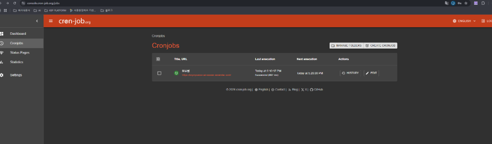

> **"설치도, 로그인도, 채팅도 없이—눈 내리는 삼나무 숲속 노천탕에서 그저 고양이가 되어 쉬어갈 수 있다면 어떨까?"**

바쁜 일상 속에서 말 한마디 섞지 않고도 타인의 온기만 조용히 느낄 수 있는 **비언어적 힐링 웹 공간 트렌드**에서 영감을 받아, '고양이'와 '겨울 노천 온천'이라는 테마로 독자 설계한 3D 웹 월드 **[고양이 온천 여관 : 묘유원(猫湯院)](https://myoyuwon-cat-onsen.onrender.com)**의 개발 후기를 공유합니다.

15년 차 백엔드 개발자로서 AI 코딩 에이전트와 협업(바이브 코딩)하며 빠르게 프로토타입을 세우고, 실제 공개 링크 배포를 앞두고 시니어 개발자의 시선으로 보안·모바일·오디오 디테일을 직접 검수하며 다듬어낸 **총 16개 커밋의 기록**입니다.

---

## 1. 프로젝트 개요 및 기술 스택

* **서비스명**: 고양이 온천 여관 : 묘유원(猫湯院)
* **접속 링크**: [https://myoyuwon-cat-onsen.onrender.com](https://myoyuwon-cat-onsen.onrender.com)
* **GitHub 저장소**: [JunHoKim21/mouwon](https://github.com/JunHoKim21/mouwon) (`main` 최신 커밋: `a4c5b4c`)
* **핵심 컨셉**: 무설치 · 무로그인 · 무채팅(Non-verbal Co-presence) 기반 16인 멀티플레이어 힐링 월드

### 기술 스택
* **Frontend**: React 19, TypeScript, Tailwind CSS v4, Three.js (`^0.187.0`), Lucide React, Vite 8.3
* **Backend / Realtime**: Express 4, `ws` 8 (WebSocket), `esbuild` 서버 번들링 (`dist-server/index.js`)

---

## 2. 가장 큰 특징: "외부 3D 모델·음원 파일 0개" (100% 프로시저럴)

이번 프로젝트를 설계하면서 가장 집착했던 기술적 원칙은 **외부 리소스 의존성 제로(Zero External Assets)**였습니다. 실제로 저장소의 `public/` 폴더 안에는 SNS 공유용 썸네일(`og-image.jpg`) 단 1장만 존재하며, `.glb`/`.gltf` 같은 3D 모델 파일이나 `.mp3`/`.wav` 같은 음원 파일이 **단 하나도 없습니다.**

### ① Three.js 기본 도형과 Canvas2D로 빚은 그래픽
* **3D 지오메트리**: Three.js의 기본 기하학 도형(Primitive) 조합만으로 6종 털 무늬(치즈태비, 삼색이, 턱시도, 고등어태비, 깜장이, 크림냥)의 고양이 아바타부터 편백탕, 난로방, 2단 바위 폭포, 족욕 데크, 눈·수증기 파티클까지 모두 구축했습니다.
* **실시간 절차적 텍스처 (`proceduralTextures.ts`)**: HTML5 Canvas2D API를 활용해 편백나무 결, 이끼 낀 돌, 창호지 문살, 대나무 마디, 고양이 털 패턴, 여관 표지판 텍스처를 런타임에 코드로 직접 그려냅니다. 또한 낮의 청량한 설경과 밤의 따뜻한 등불 조명을 버튼 하나로 전환할 수 있습니다.

### ② Web Audio API로 합성한 100% 절차적 ASMR 사운드 (`onsenAudio.ts`)
음원 파일을 스트리밍하는 대신, 브라우저의 **Web Audio API**로 핑크 노이즈(Pink Noise)를 생성하고 필터링하여 온천의 모든 소리를 실시간 합성했습니다.
* **환경음 & 발자국**: 잔잔한 온천 물결 소리, 밟는 재질(눈·나무 데크·돌길·물속)에 따라 달라지는 발자국 소리, 간헐적으로 지저귀는 오목눈이 새소리, C 메이저 5음계 대나무 실로폰.
* **26.5Hz 고양이 골골송(Purring)**: 고양이의 수면 호흡 주기에 맞춘 LFO(저주파 발진기) 변조를 적용해 진짜 고양이가 곁에서 숨 쉬며 그르렁거리는 듯한 진동음을 구현했습니다.
* **2단 폭포 3대역 캐스케이드 사운드**: 저·중·고음역 필터를 조합해 입체적인 폭포 물소리를 구현했습니다.
* **아궁이 & 화로 장작 타는 소리**: `190Hz` 대역의 불길 웅웅거림에 `8~25ms` 단위의 불규칙한 크래클(Crackle) 펄스를 얹어 장작이 타닥타닥 타들어 가는 소리를 만들어냈습니다.

---

## 3. 여관의 8대 명소와 힐링 인터랙션

묘유원은 단순한 감상용 뷰어가 아니라, 고양이 아바타를 직접 움직이며 다른 유저 및 NPC와 소소하게 교감할 수 있는 공간입니다.

1. **8대 구역 & 커스텀 2D 그리드 A\* 길찾기 (`pathfinding.ts`, `terrainMath.ts`)**
   * **8대 명소**: 온천 입구 다리, 노천 편백탕, 고양이 난로방, 따뜻한 유자 연못, 우유 자판기 & 평상, 대나무 숲 물통, 아궁이 장작터, 족욕 개울(2×6 편백 데크 & 2단 바위 폭포).
   * 바닥 아무 곳이나 클릭하면 자체 구현한 2D 그리드 A\* 알고리즘이 온천 턱, 바위 링, 나무 기둥, 난로방 화로 등의 장애물을 스스로 우회하고 계단을 통해 목적지까지 자연스럽게 이동시킵니다.
2. **비언어적 고양이 액션 & NPC 교감**
   * **코 인사(`G`) / 그루밍(`R`) / 꾹꾹이→식빵 굽기(`B`) / 입욕(`E`)**: 탕에 들어가면 머리 위에 접은 수건이나 노란 유자가 얹어집니다.
   * **산책 동행(`T`)**: 다른 고양이나 족욕 단골 NPC 고양이 '솔방울'의 뒤를 졸졸 따라다닐 수 있습니다(화면 혼잡 방지를 위해 최대 2마리 제한).
   * **꾹꾹이 25회 해금 우유 자판기**: 꾹꾹이를 25회 달성하면 자판기가 해금되어 따뜻한 우유 4종(바나나·딸기·흰우유·녹차/마타타비)을 뽑아 마시거나 주변 고양이에게 건네고 조를 수 있습니다.
   * **감사·응원 유자 쪽지**: 5가지 색깔의 유자에 최대 40자의 짧은 응원 문구를 적어 물 위에 띄워 보낼 수 있습니다.
   * **아궁이 장작 지피기 (2단계 협동)**: 장작더미에서 장작을 집어 아궁이에 투입하면 불꽃과 온천의 수증기가 한층 풍성해지며, 주변 장작 타는 소리의 화력도 함께 강해집니다.
3. **작업용 ASMR 모드 & 4:3 폴라로이드 추억 저장**
   * 마우스나 키보드 입력이 **4.5초** 동안 없으면 상·하단 HUD가 서서히 페이드아웃되어 업무나 공부 중 틀어두는 힐링 ASMR 화면으로 변합니다.
   * 입욕이나 평상 휴식 중 카메라 버튼을 누르면 촬영 날짜, 현재 구역, 내 고양이 털 무늬가 새겨진 **4:3 폴라로이드 추억 이미지**를 저장할 수 있습니다.

---

## 4. 개발 타임라인 & 실서비스 하드닝(Hardening) 트러블슈팅

AI 에이전트와 함께 뼈대를 만드는 데는 오랜 시간이 걸리지 않았습니다. 하지만 **"불특정 다수에게 공개 링크를 뿌려도 안전하고 쾌적하게 버틸 수 있는가?"**라는 질문 앞에 서자, 시니어 백엔드 개발자로서 손봐야 할 지점들이 명확하게 보이기 시작했습니다.

### Phase 1~2: 코어 3D 월드 & 16인 멀티플레이 아키텍처
* Express와 `ws`를 단일 서버로 구성해 정적 빌드 결과물(`dist/`)과 웹소켓 엔드포인트(`/ws`)를 함께 서빙하도록 구축했습니다.
* `RoomManager`(`server/roomManager.ts`)를 통해 방당 **최대 16명** 정원이 차면 자동으로 다음 방(`room-1`, `room-2`...)을 분할 생성하며, 네트워크 부하를 줄이기 위해 `100ms` 전송 스로틀링과 클라이언트 측 위치·회전 보간(Interpolation)을 적용했습니다. 서버 연결이 끊기거나 오프라인 상태일 때는 자동으로 '혼자 모드'로 폴백되어 플레이가 끊기지 않습니다.

### Phase 3: 모바일 3D 경량화 및 터치·UI 보정
* **모바일 GPU 부하 절감**: 모바일 기기 접속 감지 시 `pixelRatio` 상한을 제한하고, 안티앨리어싱과 실시간 그림자를 비활성화했으며, 파티클 수(수증기 `152→56`, 눈 `620→180`)를 대폭 경량화해 발열과 프레임 드랍을 잡았습니다.
* **터치 조작감 개선**: 캔버스 `touch-action` 제어 및 모바일 카메라 회전 감도(4배 보정)를 적용해 드래그 끊김 현상을 해결하고, 좁은 화면에서 드롭다운과 배너가 겹치는 레이아웃을 수정했습니다.

### Phase 4: 공개 배포 전 보안·모바일 생존성·오디오 최종 패치
실제 배포 직전 단계에서 직접 검수하며 막아낸 핵심 디테일들입니다.

1. **WebSocket 보안 및 스팸 도배 방어**
   * 초기 프로토타입에는 레이트리밋이나 금칙어 필터가 없어, 악의적인 유저가 1초만 도배해도 방에 떠 있는 유자 쪽지 30개가 순식간에 밀려날 수 있는 취약점이 있었습니다.
   * **해결**: WebSocket 핸드셰이크 시 `Origin`(CSWSH) 검증과 IP당 동시 소켓 5개 상한을 걸었습니다. 또한 `WeakMap` 기반 1회 직렬화 및 `bufferedAmount` 백프레셔 드롭으로 느린 클라이언트가 전체 브로드캐스트를 지연시키지 않도록 막았습니다.
   * 이벤트별 레이트리밋(유자 쪽지 60초, 대나무/장작 3초, 우유 10초)과 서버 강제 `wish.id` 부여, 금칙어·URL 정규식 차단을 도입했으며, 방의 모든 유저가 퇴장해 빈 방이 되더라도 최근 유자 쪽지와 장작 화력 상태를 서버 메모리에 보존·복원하도록 개선했습니다.
2. **'혼자 보기' 모드의 완전 격리**
   * 기존에는 `혼자 보기`를 켜면 화면 속 다른 고양이 3D 메쉬만 숨겨졌기 때문에, 원격 유저가 보낸 우유 선물 팝업이나 효과음이 화면을 뚫고 들어오는 어색함이 있었습니다. 이를 원격 알림·사운드·토스트까지 100% 차단하는 완전 격리 모드로 수정했습니다.
3. **카카오톡 인앱 브라우저 & iOS Safari 생존성 패치**
   * 한국 모바일 환경에서 가장 까다로운 **카카오톡 인앱 브라우저**에서는 Data URL 기반 `<a download>` 다운로드가 차단됩니다. 이를 해결하기 위해 Web Share API(`navigator.share({ files })`)를 최우선으로 호출하고, 카톡 인앱 감지 시 외부 브라우저 열기 유도 링크와 "이미지를 길게 눌러 저장" 안내를 추가했으며, 폴라로이드 하단에 서비스 URL 워터마크를 삽입했습니다.
   * **iOS Safari**에서 백그라운드 전환 후 복귀 시 Web Audio가 `interrupted` 상태에 빠져 무음이 되는 현상과 WebGL 컨텍스트 손실 문제를 `visibilitychange` 오디오 복원 및 `webglcontextrestored` 핸들러로 해결했습니다.
   * 지인들과 같은 온천에서 만날 수 있도록 상단 방 배지 클릭 시 `?room=` 초대 링크가 클립보드에 복사되는 기능도 더했습니다.
4. **번들 경량화 & 서버 사전 빌드 적용**
   * 미사용 패키지를 정리하고 Vite의 `manualChunks` 설정으로 무거운 `three` 코어를 별도 청크로 분리(메인 `426 kB` / `three` `577 kB` 수준)했습니다.
   * 백엔드 역시 런타임 트랜스파일러(`tsx`) 부하를 없애기 위해 `esbuild`로 사전 빌드(`dist-server/index.js`, `44.2 kB`)하도록 구성했습니다.
   * 우측 상단 `ⓘ 여관 안내` 모달에 이용 안내, 유자 쪽지 가리기/신고 문의 창구, 오픈소스 라이선스 고지를 체계적으로 정리했습니다.
5. **아궁이 장작 타는 소리 공간 음향 고도화 (`a4c5b4c`)**
   * 장작을 넣을 때 1회성 효과음만 나던 구조에서 나아가, 아궁이 화덕(`12.5m` 반경, 장작을 지필수록 화력과 음량 증가)과 난로방 화로(`9.5m` 반경) 근처에 다가가면 지속적으로 타닥타닥 들리는 거리 감쇠 기반 공간 음향을 완성했습니다.
6. **Render 무료 서버 슬립(사망) 방지 & 0초 접속 유지 (`cron-job.org` Keep-Alive 자동화)**
   * **배경**: Render의 무료 티어 인스턴스는 15분간 인바운드 트래픽이 없으면 자동으로 슬립 모드(Spin-down)로 전환되어, 다음 방문자가 들어올 때 서버 부팅에 30초~50초 이상의 긴 콜드 스타트(Cold Start) 지연이 발생합니다.
   * **해결**: 무료 외부 크론 서비스인 **[cron-job.org](https://cron-job.org)**를 연동하여, 묘유원 서버 URL로 10분마다 주기적인 경량 HTTP GET 핑(Ping)을 전송하도록 스케줄링했습니다. 이를 통해 슬립 타이머를 상시 리셋하여 추가 비용 0원으로 언제 방문해도 지연 없이 즉시 접속 가능한 **'상시 가동(Keep-Alive)'** 환경을 구축했습니다.

---

## 5. 빌드 및 테스트 검증 결과

배포 전 전체 코드베이스에 대해 정적 분석, 단위 테스트, 프로덕션 빌드를 모두 검증했습니다.

* **TypeScript 타입 체크 (`npm run lint`)**: 오류 0건 통과
* **단위 테스트 (`npx tsx --test server/*.test.ts src/world/*.test.ts`)**: **49 / 49 전부 통과**
  * 2D 그리드 A\* 길찾기 및 장애물 충돌, NPC 산책 대열 제한, 거리 기반 오디오 감쇠, WebSocket 프로토콜 유효성, 레이트리밋·금칙어 필터링, 빈 방 상태 복원, `?room=` 지정 합류 로직 검증 완료
* **프로덕션 빌드 (`npm run build`)**: 클라이언트(`vite build`) 및 서버(`esbuild`) 번들 정상 생성 확인

---

## 6. 운영 현황 및 마치며

현재 **묘유원(猫湯院)**은 별도의 회원가입, 결제, 데이터베이스 없이 누구나 링크만 누르면 3초 만에 고양이로 변신해 쉴 수 있는 가벼운 체험형 웹 월드로 운영되고 있습니다. 

* **운영 및 인프라 최적화**: Render 무료 플랜을 사용 중이지만 앞서 설명한 `cron-job.org` 자동 핑(Keep-Alive) 파이프라인 덕분에 콜드 스타트 없이 상시 쾌적한 접속 속도를 유지하고 있습니다. 추후 글로벌 트래픽 추이에 따라 상시 인스턴스 환경으로의 확장도 고려하고 있습니다.

AI 코딩 에이전트 덕분에 3D 그래픽과 Web Audio 합성이라는 방대한 영역을 1인 개발로도 단기간에 구현할 수 있었지만, 결국 서비스를 '장난감'에서 '프로덕트'로 끌어올리는 마지막 20%는 네트워크 백프레셔, 인앱 브라우저 예외 처리, 레이트리밋, 메모리 상태 복원 같은 **기본기 있는 엔지니어링**에 달려 있음을 다시 한번 체감한 프로젝트였습니다.

오늘 하루 조금 지치셨다면, 잠시 브라우저 탭을 열고 따뜻한 편백탕에 몸을 담가보세요. 🍊♨️

👉 **[고양이 온천 여관 : 묘유원 입장하기](https://myoyuwon-cat-onsen.onrender.com)**

## 🔗 관련 링크 & 저장소

본 프로젝트의 전체 소스 코드와 커밋 히스토리는 아래 GitHub 저장소에서 확인하실 수 있습니다. 도움이 되셨다면 Star ⭐️ 부탁드립니다!

* **GitHub Repository**: [👉 JunHoKim21/mouwon](https://github.com/JunHoKim21/mouwon)