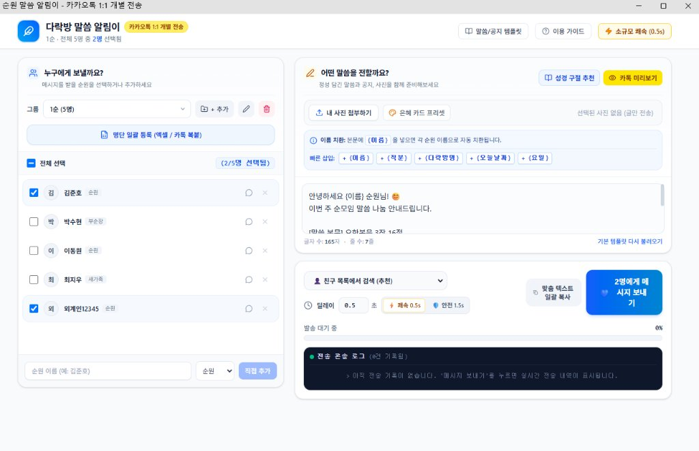
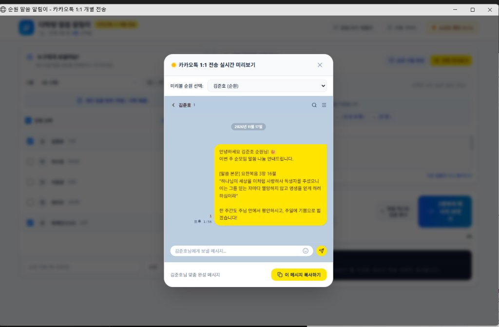
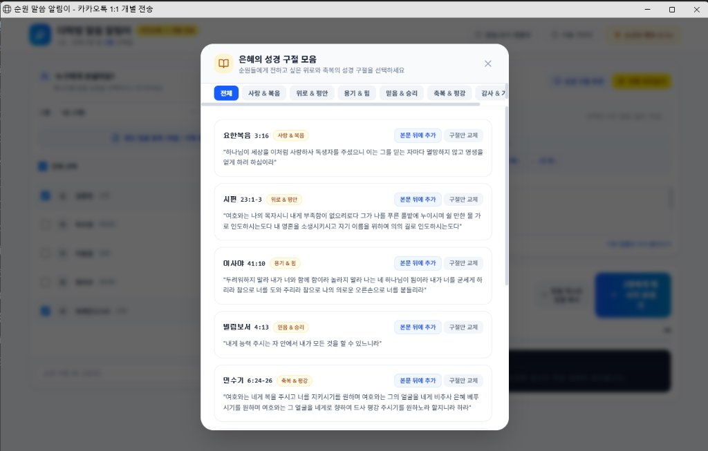

> **"매주 반복되는 30여 명의 1:1 맞춤 말씀과 주보 사진 전송—클라우드 유료 API나 사설 프로토콜 위험 없이, 내 PC의 카카오톡을 가장 안전하고 정교하게 제어할 수 없을까?"**

교회 다락방/순 소모임 리더나 단체 운영자가 겪는 가장 번거로운 일 중 하나는 매주 정기적으로 개별 인원의 이름을 넣은 맞춤형 안부/공지 텍스트와 주보·포스터 사진을 1:1로 일일이 전송하는 작업입니다.

건당 비용이 발생하는 유료 알림톡 비즈니스 API를 쓰기엔 부담스럽고, 카카오톡 사설 프로토콜(LOCO) 라이브러리는 계정 영구 정지(제재) 위험이 매우 큽니다. 이에 15년 차 백엔드 개발자의 시선에서 **PC 카카오톡 GUI를 정식으로 제어하되, 오발송 0%와 사용자 작업 방해 최소화**를 달성한 Windows 전용 데스크톱 RPA 프로그램 **[KakaoNotifier v3.0](https://github.com/JunHoKim21/kokaoSend.git)**의 개발 과정과 핵심 기술 트러블슈팅을 정리합니다.

---

## 1. 프로젝트 개요 & 아키텍처 개관



* **서비스명**: 카카오톡 순원 말씀/공지 자동 발송기 (KakaoNotifier v3.0)
* **GitHub 저장소**: [JunHoKim21/kokaoSend](https://github.com/JunHoKim21/kokaoSend.git) (`main` 브랜치 최신 커밋 `63cb494`)
* **핵심 컨셉**: 1:1 이름 맞춤 치환 텍스트 + 고화질 사진을 원클릭으로 일괄 전송하는 독립 실행형 윈도우 RPA 솔루션
* **구동 방식**: 로컬 Flask REST API + Chromium App 모드 경량 웹 뷰어 (`http://127.0.0.1:5000`)

### 🛠️ 기술 스택 상세

| 영역 | 기술 스택 및 버전 | 핵심 역할 |
| :--- | :--- | :--- |
| **Frontend** | React 19.0.1, TypeScript 7.0.2, Vite 8.3.1, Tailwind CSS 4.3.3 | 반응형 싱글 페이지 대시보드, 1:1 실시간 미리보기, 모달 제어 |
| **UI/UX 라이브러리** | Motion (Framer Motion) 12.23.24, Lucide React 0.546.0, Canvas-Confetti 1.9.4 | 세련된 인터랙션 애니메이션, 아이콘, 발송 성공 축하 이펙트 |
| **Backend Bridge** | Python 3.12.10, Flask 3.0.0+, Flask-CORS 4.0.0+ | 로컬 REST API 브릿지, SPA 정적 에셋 서빙, SSE 발송 스트리밍 |
| **Native RPA Engine** | `pywin32` (306+), `ctypes` (user32, shcore), `pyperclip`, `Pillow`, `uiautomation` | 윈도우 핸들(HWND) 열거, 클립보드 DIB 포맷 주입, 2중 검증, 포커스 복원 |
| **Database** | 브라우저 `localStorage` (무DB 구조) | 그룹/명단/템플릿 본문/딜레이 옵션 등 영구 로컬 저장 |
| **Packaging** | PyInstaller 6.21.0 (Onedir 디렉터리 번들 모드) | Node.js/Python 무설치 독립 실행 바이너리(`KakaoNotifier.exe`) 패키징 |

---

## 2. 기술적 차별점 4가지

### ① 비용 0원 & 계정 제재 위험 없는 순수 로컬 자동화 (No Cloud, No Paid API)
* 카카오 비즈니스 알림톡(건당 과금)이나 불안정한 비공식 사설 네트워크 프로토콜을 전혀 쓰지 않습니다.
* 사용자가 이미 로그인해 둔 공식 PC 카카오톡의 윈도우 핸들(HWND)과 단축키 파이프라인을 정식으로 제어하므로 **비용이 0원**이며, 계정 정지 위험으로부터 안전합니다.

### ② Electron을 대체한 초경량 Chromium App Mode (용량 85% 절감)
* 150MB~200MB에 달하는 무거운 Electron 런타임을 통째로 번들링하지 않았습니다.
* Windows에 기본 탑재된 `msedge.exe` 또는 `chrome.exe`의 독립 앱 모드(`--app=http://127.0.0.1:5000 --user-data-dir=...`)를 호출하여, 주소창과 메뉴바가 없는 네이티브 데스크톱 앱 UX를 구현하면서도 배포 압축본 용량을 **25MB 수준**으로 혁신했습니다.

### ③ Server-Sent Events (SSE) 기반 실시간 발송 스트리밍
* 무거운 양방향 웹소켓 대신, 경량 단방향 스트리밍인 **SSE(`/api/send-stream`)**를 구축했습니다.
* 백엔드 스레드의 발송 큐(`queue.Queue`) 상태와 현재 진행률(%), 성공/실패 카운트, 단계별 상세 디버그 로그가 프론트엔드로 끊김 없이 실시간 브로드캐스팅됩니다.

### ④ 완벽한 개인정보 보호 (Zero External Server)
* 순원 명단, 전화번호, 개인 메모 등 민감 정보는 오직 사용자의 브라우저 `localStorage`와 로컬 메모리에만 상주하며, 외부 서버로 1바이트도 유출되지 않습니다.

---

## 3. 핵심 기능 및 엔지니어링 구현 로직

### 1) 1:1 맞춤형 템플릿 치환 & 카톡 프리뷰 모달
* **관련 모듈**: `frontend/src/utils/messageHelper.ts`, `api_server.py`
* 프론트엔드와 백엔드가 완전히 동일한 정규식 치환 엔진을 공유합니다:
  ```typescript
  // {이름}, {순명}, {직분}, {오늘날짜}, {요일} 키워드 자동 치환
  formatted = formatted.replace(/\{이름\}/g, member.name);
  formatted = formatted.replace(/\{순명\}/g, member.groupName || '');
  formatted = formatted.replace(/\{직분\}/g, member.role || '');
  ```
* 전송 전 모달에서 실제 카카오톡 말풍선과 동일한 UI로 개별 인원별 최종 렌더링 문구를 100% 일치하게 미리 확인할 수 있습니다:



* 또한 테마별(사랑&복음, 위로&평안, 용기&힘, 믿음&승리, 축복&평강, 감사&기쁨 등) 엄선된 성경 말씀과 상황별 공지 템플릿을 원클릭으로 본문에 삽입하거나 교체할 수 있는 추천 모달을 제공하여 메시지 작성 편의성을 극대화했습니다:



### 2) 엑셀 및 카톡 텍스트 스마트 일괄 명단 파싱
* 엑셀에서 복사한 탭 구분 텍스트(`이름\t전화번호\t직분`)나 카톡 단톡방에서 복사한 줄바꿈 명단을 자동으로 판별합니다.
* `name.replace(/^\d+[\.\)\-\s]+/, '')` 전처리를 통해 `1. 홍길동`, `(2) 이순신` 등 복사 시 묻어오는 순번 프리픽스를 자동으로 정제합니다.

### 3) 클립보드 DIB 포맷 직접 주입을 통한 텍스트 + 사진 동시 발송
* 텍스트와 사진을 하나의 흐름 안에서 자연스럽게 연속 전송하기 위해 Windows의 **DIB(Device Independent Bitmap)** 포맷을 활용했습니다:
  ```python
  # Pillow로 이미지를 읽어 Windows 클립보드 표준 DIB 버퍼로 변환
  image = Image.open(image_path).convert('RGB')
  output = io.BytesIO()
  image.save(output, 'BMP')
  data = output.getvalue()[14:]  # 14바이트 BMP 파일 헤더 제거 후 순수 DIB 추출
  win32clipboard.SetClipboardData(win32clipboard.CF_DIB, data)
  ```
* 클립보드에 주입된 이미지는 대화방 창에 `Ctrl+V`로 붙여넣고, 카카오톡 특유의 사진 전송 확인 팝업을 감지하여 엔터키를 자동 전송합니다.

### 4) 동적 조건 폴링(`poll_until`) 기반 단일 원자적 파이프라인
* 구버전의 고정 `time.sleep()` 방식은 PC 사양이나 네트워크 지연에 따라 타이밍이 어긋나 오작동하는 치명적 한계가 있었습니다.
* 이를 해결하기 위해 **25ms 간격의 논블로킹 조건 감지 유틸리티(`poll_until`)**를 도입하여 전 과정을 단일 원자적 함수(`send_kakao_message_atomic`)로 캡슐화했습니다:

```text
[작업 중이던 이전 창 HWND 저장]
  ↓
[카톡 메인 창 확인 및 이전 대화방 일괄 닫기]
  ↓
[단축키 검색창 초기화 ➔ 대상자 이름 입력]
  ↓
[대화방 창 생성 감지 (Delta HWND)]
  ↓
[2중 수신자 타이틀 검증 (verify_recipient)] ──(불일치 시)──> 즉시 Esc 닫기 및 스킵
  ↓ (일치 시)
[미세 포커스 활성화 (0.3초)]
  ↓
[클립보드 주입 & 엔터 전송 (텍스트 + 사진)]
  ↓
[대화방 닫기 (Esc)]
  ↓
[사용자가 보던 이전 작업 창으로 포커스 복원 (restore_foreground)]
```

### 5) 2중 수신자 타이틀 검증 (오발송 0% 원천 차단)
* 단체방이나 다른 동명이인에게 공지가 잘못 들어가는 대형 사고를 막기 위해, 대화방 오픈 직후 Win32 `GetWindowText`와 UIA `ControlFromHandle(hwnd).Name`을 교차 확인합니다.
* 창 제목이 전송 대상자명(`target_name`)과 정확히 일치하지 않거나, 단체방 구분자(`,`, `그룹`, `오픈채팅`)가 포함된 경우 발송을 강제 중단하고 대화방을 즉시 닫습니다.

### 6) 0.3초 스마트 포커스 획득 & 이전 작업 창 자동 복원
* 발송 루프 진입 전 `win32gui.GetForegroundWindow()`로 사용자의 현재 창을 기록합니다.
* `HWND_TOPMOST`와 `keybd_event(VK_MENU)` 트릭으로 카카오톡 창을 일시적으로 전경으로 올린 뒤 단 **0.2~0.3초 만에 주입을 끝내고**, `finally` 블록에서 `restore_foreground()`를 호출해 원래 작업 창으로 되돌려 놓습니다.

---

## 4. 실전 트러블슈팅 & 엔지니어링 기록

### 🔥 Issue 1. 카카오톡 Qt(C++) 엔진 한계와 백그라운드 전송 실패 (커밋 `63cb494`)
* **현상**: Windows UI Automation(UIA)을 이용해 사용자의 화면을 전혀 방해하지 않는 완전 무포커스 백그라운드 발송을 구현하려 했으나 실패.
* **Root Cause 규명**:
  1. 최신 PC 카카오톡은 표준 Win32 창이 아닌 **Qt SceneGraph**로 렌더링되어, 친구 목록 엘리먼트들이 단일 Pane으로 묶여 UIA 트리에서 개별 탐색이 불가능합니다.
  2. 메시지 입력창에 UIA `ValuePattern.SetValue()` 호출 시 `NotSupportedException`이 발생합니다.
  3. 비활성 창에 `SendMessage(WM_KEYDOWN, VK_RETURN)`를 날려도, 카카오톡 내부 이벤트 루프가 포커스 없는 엔터 입력을 메시지 전송으로 처리하지 않고 씹는(무시하는) 구조입니다.
  4. OS 클립보드는 전역 단일 자원이므로, 사용자가 타이핑 중일 때 백그라운드 클립보드 주입이 발생하면 다른 프로그램에 내용이 오붙여넣기 되는 충돌이 발생합니다.
* **해결 (하이브리드 아키텍처)**:
  * 검색 진입은 가장 확실한 `Ctrl+F` ➔ `Down` ➔ `Enter` 단축키 파이프라인을 유지.
  * 윈도우 타이틀 판별에 UIA Name과 Win32 API를 혼합 적용.
  * 주입 순간(0.3초)만 미세하게 포그라운드를 점유하고 전송 즉시 이전 창으로 포커스를 복원하는 스마트 하이브리드 방식으로 안정성을 확보했습니다.

### 🔥 Issue 2. 고정 Sleep 딜레이로 인한 전송 병목 (커밋 `63cb494`)
* **현상**: 스텝마다 `time.sleep(0.5)`를 주다 보니 30명 전송 시 무려 1분 30초 이상이 소요됨.
* **해결**: 25ms 단위의 논블로킹 조건 감지(`poll_until`)를 도입하여 창 핸들이 감지되거나 사진 팝업이 뜨는 즉시 다음 단계로 넘어가도록 개선. 대기 시간을 40% 이상 단축하여 발송 속도를 약 **1.5배** 앞당겼습니다.

### 🔥 Issue 3. PyInstaller 단일 실행 파일 기동 즉시 크래시
* **현상**: `--onefile`로 빌드한 `KakaoNotifier.exe`를 실행하면 창이 0.1초 만에 꺼지며 에러 발생:
  ```text
  [PYI-33992:ERROR] Failed to extract base_library.zip: failed to open target file! fopen: Permission denied
  ```
* **Root Cause**: 임시 폴더(`%TEMP%/_MEI...`)에 수십 MB를 압축 해제하는 찰나에 Windows Defender의 실시간 검사가 파일 락을 걸어 권한 오류가 발생함.
* **해결**: PyInstaller 스펙을 `COLLECT` 기반의 **Onedir(디렉터리 번들) 모드**로 전환. 임시 폴더 압축 해제 과정을 원천 배제하여 더블클릭 즉시 0.1초 만에 기동되도록 안정화했습니다.

### 🔥 Issue 4. 데스크톱 저해상도 화면에서 UI 하단 잘림 (커밋 `18897ed`)
* **현상**: 노트북 모니터에서 [발송 시작] 버튼과 실시간 로그 창이 화면 아래로 밀려 스크롤해야만 보이는 문제.
* **해결**: 루트 컨테이너를 `h-screen`, `overflow-hidden`으로 묶고, 좌/우측 패널에 `flex-1`, 내부 리스트 영역만 `overflow-y-auto`를 적용하여 어떤 해상도에서도 스크롤 없이 한 화면에 온전히 대시보드가 들어오도록 반응형 레이아웃을 개편했습니다.

### 🔥 Issue 5. Vite와 esbuild 피어 의존성 충돌
* **현상**: 프론트엔드 환경에서 `npm install` 시 `esbuild` 버전 피어 의존성 충돌 발생.
* **해결**: `npm install --legacy-peer-deps` 옵션을 통해 정적 빌드 환경을 정상화했습니다.

---

## 5. 검증 결과 및 산출물 스펙

* **TypeScript 타입 체크**: `npm run lint` (`tsc --noEmit`) ➔ **오류 0건 (Exit Code 0 통과)**
* **Python 백엔드 컴파일**: `python -m py_compile api_server.py kakao_sender.py` ➔ **구문 오류 0건 통과**
* **Vite 프로덕션 빌드 속도**: **424ms**
  * `dist/index.html`: `1.30 kB`
  * `dist/assets/index.css`: `46.47 kB`
  * `dist/assets/index.js`: `414.64 kB`
  * 총 번들 용량: 약 **462 kB** (gzip 압축 시 약 136 kB)
* **최종 배포 바이너리**:
  * 메인 실행 파일: `dist/KakaoNotifier/KakaoNotifier.exe` (7.16 MB)
  * 전체 배포 압축본: `release/KakaoNotifier_v3.0_배포용.zip` (약 **25.0 MB**)

---

## 6. 한계점 및 향후 과제

1. **Windows OS 종속성**:
   * `pywin32`, `ctypes(user32)` 기반 Windows 메시지 큐를 제어하므로 macOS/Linux 미지원.
2. **PC 카카오톡 로그인 선행 필수**:
   * PC 카톡이 사전에 로그인된 상태여야 작동하며, 잠금 모드 상태에서는 검색 진입 불가.
3. **친구 등록 이름 일치 필요**:
   * 주소록에 저장된 이름과 전송 대상자 이름이 오탈자 없이 일치해야 탐색 성공.
4. **향후 계획**:
   * 비개발자 배포 시 SmartScreen 경고 최소화를 위한 코드 사이닝 인증서 검토.
   * 발송 예약 타이머 기능 추가.

🔗 관련 링크 & 저장소

본 프로젝트의 전체 소스 코드와 커밋 히스토리는 아래 GitHub 저장소에서 확인하실 수 있습니다. 도움이 되셨다면 Star ⭐️ 부탁드립니다!

GitHub Repository: 👉 (https://github.com/JunHoKim21/kokaoSend)